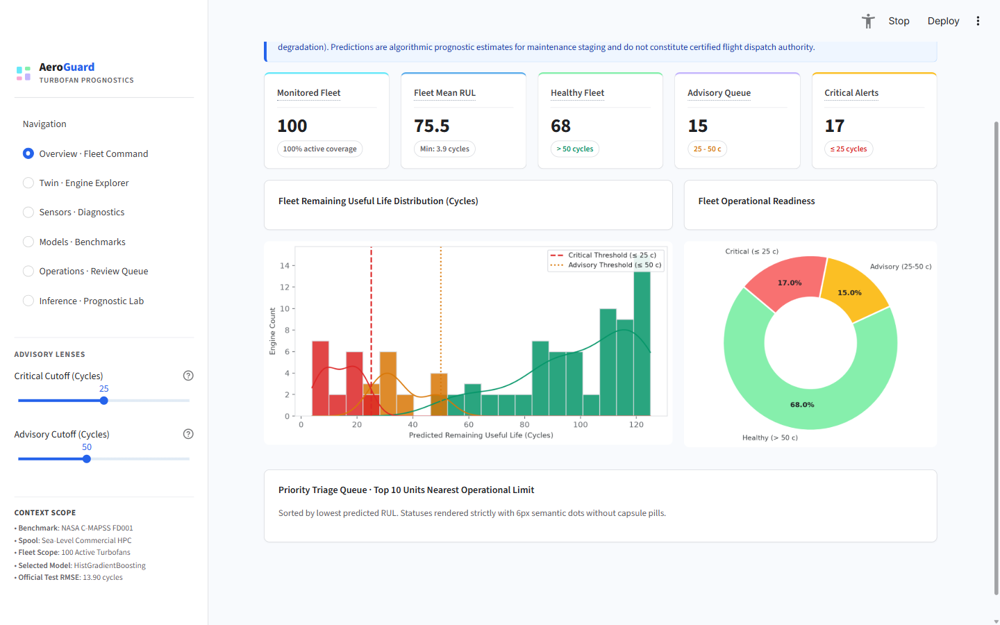
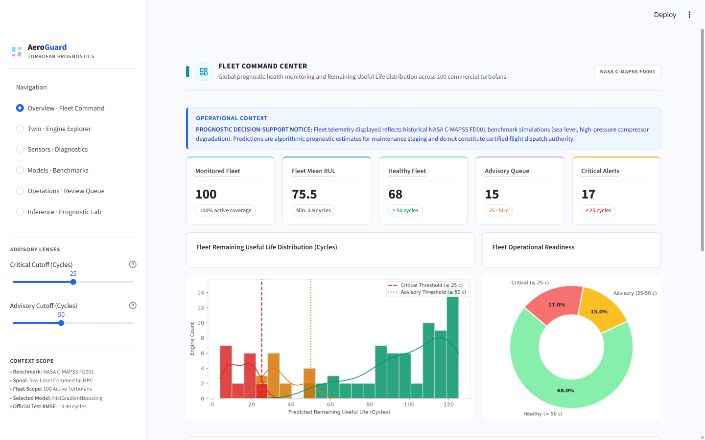
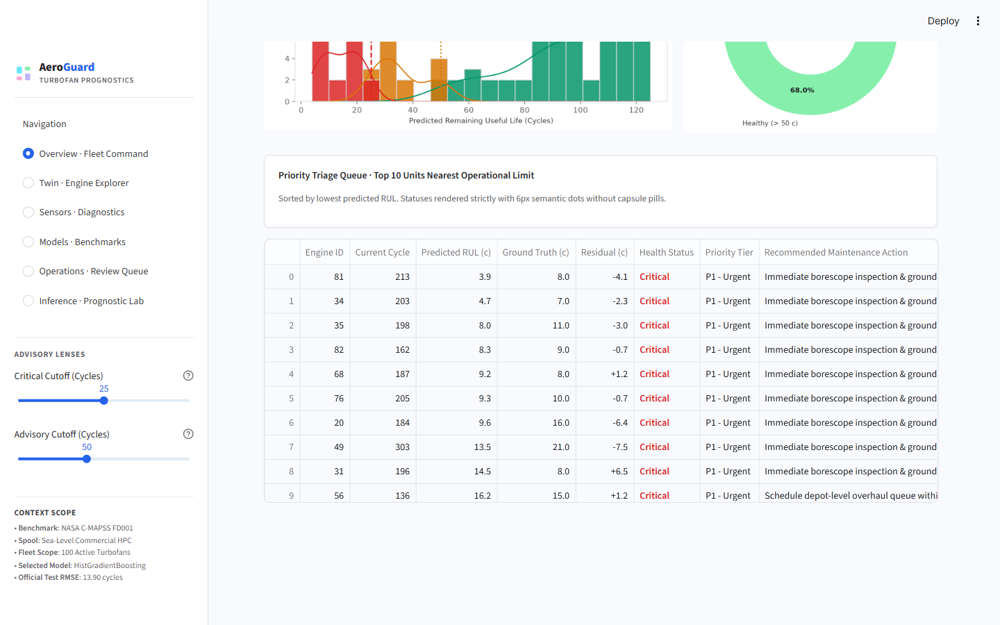
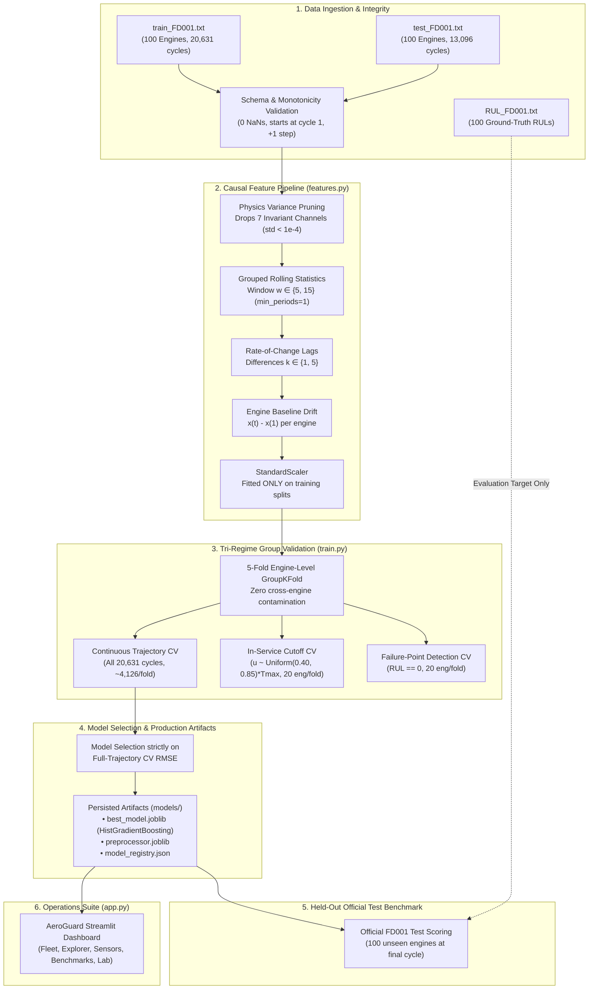

# AeroSentinel / AeroGuard: Integrity-Assured Machine Learning for Aircraft Predictive Maintenance

[](https://www.python.org/)
[](https://scikit-learn.org/)
[](docs/research/security_model.md)
[](tests/)
[](frontend/)
[](data/raw/)
[](docs/research/manuscript_aerosentinel_draft.md)

An end-to-end research and engineering framework examining **integrity controls, cryptographic supply-chain authentication, and sensor-manipulation resilience** in turbofan remaining-useful-life (RUL) predictive maintenance pipelines using the **NASA C-MAPSS FD001** benchmark.

---

## 🔬 Research & Security Documentation
- [Research Specification & Threat Model](docs/research/research_specification.md) — Problem formulation, RQs, and STRIDE analysis.
- [Experimental Methodology](docs/research/methodology.md) — Feature pipeline, dual evaluation protocols, and drift metrics.
- [Security Model & Cryptographic Verification](docs/research/security_model.md) — Ed25519 signing, canonical JSON, and API hardening.
- [Scientific Limitations & Aviation Disclaimers](docs/research/limitations.md) — Operational boundaries and synthetic data scope.
- [Experiment Reproduction Guide](docs/research/experiment_reproduction.md) — Reproduction commands and benchmark procedures.
- [Literature Review & Verified Matrix](docs/research/literature_review.md) — 13 peer-reviewed citations across 6 research pillars.
- [Verified Experimental Results](docs/research/experiment_results.md) — Dual baseline, attack outcomes, and latency benchmarks.
- [IJSART Formatting & Submission Checklist](docs/research/ijsart_formatting_checklist.md) — Verified journal formatting rules.

---

## 🖥️ AeroGuard Operations Suite (Yafa-UI Live Dashboard)

The AeroGuard Streamlit dashboard provides airline fleet managers and maintenance engineers with a calm, high-density, analytical instrument built on the **Yafa-UI Dashboard Design System** (`#f8fafd` canvas, white surfaces, `#dadce0` borders, multi-color KPI strips, 6px semantic status dots, and Lucide vector icons) across six dedicated routes:

### 1. Fleet Command Center
Global prognostic monitoring across 100 active commercial turbofans, fleet-wide RUL distribution, operational health breakdown (Healthy, Advisory, Critical), and highest-priority units requiring earliest intervention.


### 2. Engine Digital Twin & Degradation Explorer
Cycle-by-cycle operational inspection distinguishing active truncated test units from run-to-failure historical baselines. Multi-sensor degradation curves track raw signals against causal moving averages with physical engineering units ($T_{24}, T_{30}, T_{50}, P_{s30}, \Phi, BPR$).


### 3. Sensor Intelligence & Physical Diagnostics
Physical engineering catalogue of all 21 sensors and 3 operational settings, variance diagnostics demonstrating why 7 invariant channels are pruned, normalized lifetime degradation trends, and Spearman rank correlation heatmaps.


### 4. Model Intelligence & Evaluation Benchmarks
Transparent side-by-side performance comparisons across baseline, regularized linear, and tree-based ensembles across 4 distinct evaluation regimes (Official Test, In-Service Cutoff CV, Continuous Trajectory CV, and Terminal Failure CV). Includes residual error distributions and Gini feature importances.


### 5. Maintenance Operations & Prioritized Review Queue
Configurable advisory threshold sliders (Critical and Advisory cutoffs), dynamic triage queue with engineering rationales, severity filtering, and direct CSV worklist export (`aeroguard_maintenance_queue.csv`).


### 6. RUL Inference Lab & Sensitivity Testing
Interactive prognostic simulator allowing engineers to select any active turbofan and cycle point, inspecting the causal 122-feature vector transform, unclipped vs. clipped model predictions, and actionable maintenance advisories.


---

## 🏗️ System Architecture & Data Pipeline



---

## ⚙️ Key Engineering & Architectural Decisions

### 1. Causal Feature Engineering (Zero Future Lookahead)
In predictive maintenance, feature leakage from future cycles or inter-engine boundaries will catastrophically inflate offline validation scores while failing in flight.
- **Strict Grouping**: Rolling aggregations (`rolling(window=w)`) and differences (`diff(k)`) are grouped by `engine_id`. A rolling calculation for Engine 2 never accesses rows from Engine 1.
- **Strictly Historical**: At operational cycle $t$, features are calculated exclusively over cycles $[t-w+1, t]$. No centered rolling windows, backward fills, or forward lookaheads are permitted.
- **Baseline Drift**: Initial engine condition $x(1)$ serves as the baseline, computing causal degradation drift $x(t) - x(1)$ without requiring knowledge of total engine lifetime $T_{\text{max}}$.

### 2. Physics-Informed Sensor Pruning
Under Sea-Level operation in FD001, 7 channels exhibit zero or near-zero variance ($\sigma < 10^{-4}$):
- `setting_3`: Throttle Resolver Angle (constant 100.0)
- `sensor_1`: Fan Inlet Temperature $T_2$ (constant 518.67 °R)
- `sensor_5`: Fan Inlet Pressure $P_2$ (constant 14.62 psia)
- `sensor_10`: Engine Pressure Ratio $epr$ (constant 1.30)
- `sensor_16`: Burner Fuel-Air Ratio $farB$ (constant 0.03)
- `sensor_18`: Demanded Fan Speed $N_{f\_dmd}$ (constant 2388 rpm)
- `sensor_19`: Demanded Corrected Fan Speed $PCNfR\_dmd$ (constant 100.0 rpm)

Pruning these 7 non-informative channels removes multi-collinearity and eliminates numerical instability in linear scalers.

### 3. Piecewise Linear Target Clipping Policy
Engines begin service in a nominal healthy state where degradation has not initiated. C-MAPSS literature establishes that predicting whether a healthy engine will last 250 vs. 300 cycles forces models to fit random sensor noise.
- Training targets are clipped at $RUL_{\text{max}} = 125$ cycles:
  $$y = \min(T_{\text{max}} - t, 125)$$
- When evaluated against the piecewise linear target (`test_rmse_clipped`), the production model achieves **13.01 RMSE**.
- When evaluated against the raw unclipped competition ground truth (`test_rmse_official`), where test targets extend up to 145 cycles, it achieves **13.90 RMSE**. Both metrics are explicitly reported.

### 4. Tri-Regime Validation & Zero Test-Label Snooping
To prevent methodological conflation, validation metrics are split into three distinct, non-overlapping regimes:
1. **Continuous Trajectory Monitoring**: Evaluates full lifecycle degradation tracking across all 20,631 training cycles.
2. **In-Service Cutoff Prognosis**: Truncates validation trajectories at inspection fractions $u_i \in [0.40, 0.85] \times T_{\text{max}}$ chosen deterministically without consulting official test labels, scoring strictly against actual remaining cycles $T_{\text{max}} - t_{\text{cutoff}}$.
3. **Failure-Point Detection**: Measures near-zero prediction accuracy at the engine breakdown point ($t = T_{\text{max}}, RUL \equiv 0$).

---

## 📊 Benchmark Results

### 1. 5-Fold Engine-Level GroupKFold Cross-Validation (Training Data Only)
*Fold isolation strictly verified; zero test labels consulted.*

| Model Architecture | 1. Continuous Trajectory CV RMSE (`~4,126` cycles/fold) | 2. In-Service Cutoff CV RMSE (`20` engines/fold) | 3. Failure-Point Detection CV RMSE (`RUL=0`, `20` engines/fold) | Selection Status |
|---|---|---|---|---|
| **Dummy (Mean Baseline)** | 41.67 ± 0.00 | 30.03 ± 2.27 | 86.83 ± 0.01 | Naive Baseline |
| **Ridge Regression** | 16.21 ± 1.55 | 21.39 ± 1.81 | **1.56 ± 1.22** | Regularized Linear |
| **Random Forest** | 14.05 ± 1.21 | 19.69 ± 1.99 | 2.43 ± 0.25 | Non-linear Tree |
| **HistGradientBoosting** | **13.76 ± 1.57** | **19.52 ± 2.84** | 3.35 ± 0.27 | **Selected Production** |

*Model selection is strictly driven by Full-Trajectory CV RMSE (zero test set snooping).*

### 2. Official FD001 Held-Out Test Set Benchmark (100 Unseen Test Engines)
*Evaluated on the 100 test engines strictly at their terminal observed cycle against official `RUL_FD001.txt` ground truth:*

| Model Architecture | Official Test RMSE (Unclipped) | Test RMSE (Clipped @ 125) | Official Test MAE | Official Test R² | Official NASA Score Total | Official NASA Score / Engine |
|---|---|---|---|---|---|---|
| **Dummy (Mean Baseline)** | 43.07 | 41.94 | 35.90 | -0.076 | 33,629.2 | 336.29 |
| **Ridge Regression** | 17.42 | 16.41 | 14.40 | 0.824 | 458.5 | 4.59 |
| **Random Forest** | 14.44 | 13.59 | 10.77 | 0.879 | 351.9 | 3.52 |
| **HistGradientBoosting (Production)** | **13.90** | **13.01** | **10.40** | **0.888** | **302.0** | **3.02** |

> **Official NASA PHM 2008 Asymmetric Scoring Function:**  
> In aerospace operations, predicting failure late ($d_i = \hat{y}_i - y_i > 0$) risks in-flight failure, whereas predicting early ($d_i < 0$) causes premature maintenance. The scoring function penalizes late predictions exponentially more severely:  
> $$s_i = \begin{cases} \exp(-d_i / 13) - 1, & d_i < 0 \text{ (Early prediction, safe)} \\ \exp(d_i / 10) - 1, & d_i \ge 0 \text{ (Late prediction, high penalty)} \end{cases}$$  
> Total Score $S = \sum_{i=1}^N s_i$. Lower is better; 0 is perfect.  
> - **Full-Trajectory CV**: Evaluates **4,126 cycles/fold** ($S \approx 16,213$, or **3.93 per prediction**).  
> - **Official Test Set**: Evaluates **100 terminal engines** ($S = 302.0$, or **3.02 per engine**).  
> Reporting the normalized per-sample rate ensures mathematical equivalence across different fleet sizes.

---

## ⚠️ Operational Limitations & Flight Operations Context

1. **Cutoff-Schedule Limitation**:  
   The in-service cutoff validation protocol selects inspection points by sampling $u_i \sim \text{Uniform}(0.40, 0.85)$ across an engine's total lifetime. While this eliminates test-label leakage and tests model behavior on truncated trajectories without failure symptoms, real-world commercial airline inspections follow fixed flight-hour/calendar intervals (e.g. Line checks, A-checks every 400-600 hours, C-checks every 18-24 months) or condition-based exceedance alerts rather than uniform lifespan fractions. Real in-service prognostic performance will depend on the airline's specific inspection schedule.
2. **Piecewise Saturation for Nominal Units**:  
   Because the training target is capped at 125 cycles, predictions for healthy engines with $>125$ cycles remaining are clipped. This prioritizes accuracy near the maintenance decision window, but cannot differentiate between an engine with 160 cycles remaining and one with 260 cycles remaining.
3. **Single Flight Envelope (FD001 Scope)**:  
   FD001 reflects single-condition sea-level flight. Fleets operating across dynamic flight envelopes (such as FD002/FD004 with 6 altitude/Mach combinations) will require operational setting clustering or flight-regime normalization.

---

## 🚀 Quickstart & Commands

### 1. Environment Setup
```powershell
# Activate existing Windows virtual environment
.\.venv\Scripts\Activate.ps1
```

### 2. Run Data Inspection & Validation
```powershell
$env:PYTHONPATH="src"
python src/inspect_data.py
```

### 3. Generate Exploratory Data Analysis (EDA) Charts
Generates high-resolution figures in `reports/figures/` and writes `reports/eda_summary.md`:
```powershell
$env:PYTHONPATH="src"
python -m aircraft_pm.eda
```

### 4. Train Models & Execute Benchmark Suite
Executes 5-fold GroupKFold cross-validation, selects the best model, scores official held-out test trajectories, and writes `reports/model_evaluation_report.md`:
```powershell
$env:PYTHONPATH="src"
python -m aircraft_pm.models.train
```

### 5. Run Automated Test Suite
Executes all 22 unit, integration, and regression tests:
```powershell
$env:PYTHONPATH="src"
pytest -v tests/
```

### 6. Launch the AeroGuard Streamlit Dashboard
```powershell
$env:PYTHONPATH="src"
streamlit run src/aircraft_pm/app.py
```
Open [http://localhost:8501](http://localhost:8501) in your browser.

---

## 📁 Repository Structure

```
aircraft-predictive-maintenance/
├── data/
│   ├── raw/                      # C-MAPSS FD001 dataset
│   │   ├── train_FD001.txt       # 100 run-to-failure engines (20,631 cycles)
│   │   ├── test_FD001.txt        # 100 truncated test engines (13,096 cycles)
│   │   └── RUL_FD001.txt         # 100 ground-truth test RUL values
│   └── processed/                # Caches
├── models/
│   ├── best_model.joblib         # Production model (HistGradientBoosting)
│   ├── preprocessor.joblib       # Fitted feature transformation pipeline
│   ├── model_registry.json       # JSON benchmark registry
│   ├── histgradientboosting.joblib
│   ├── random_forest.joblib
│   └── ridge_regression.joblib
├── reports/
│   ├── eda_summary.md            # Statistical summary of fleet and sensors
│   ├── model_evaluation_report.md# Formal evaluation report across all regimes
│   └── figures/
│       ├── screenshots/          # Live Streamlit dashboard screenshots
│       │   ├── fleet_command.png
│       │   ├── engine_twin.png
│       │   ├── sensor_intelligence.png
│       │   ├── model_intelligence.png
│       │   ├── maintenance_ops.png
│       │   └── rul_inference_lab.png
│       ├── engine_lifetime_distribution.png
│       ├── sensor_variance_profile.png
│       ├── sensor_degradation_trajectories.png
│       ├── sensor_correlations.png
│       ├── model_test_predictions.png
│       ├── model_residuals.png
│       └── feature_importances.png
├── src/
│   ├── inspect_data.py           # Preserved data inspection script
│   └── aircraft_pm/
│       ├── __init__.py
│       ├── config.py             # Schema, paths, sensor definitions, constants
│       ├── data.py               # Data loading, validation, and RUL labeling
│       ├── features.py           # Causal rolling/lag feature engineering
│       ├── metrics.py            # NASA PHM score & regression metrics
│       ├── operations.py         # Health classification, priority queue & CSV export
│       ├── yafa_ui.py            # Yafa-UI dashboard components, Lucide icons & tokens
│       ├── eda.py                # EDA generator and chart plotting
│       ├── models/
│       │   ├── __init__.py
│       │   └── train.py          # CV training and official test evaluation
│       └── app.py                # Streamlit operations suite (6 cohesive sections)
├── tests/
│   ├── test_data.py              # Data schema, missing value, and RUL tests
│   ├── test_features.py          # Leakage-safety and temporal causality tests
│   ├── test_metrics.py           # NASA PHM score & metric validation tests
│   ├── test_models.py            # Model instantiation and inference tests
│   ├── test_end_to_end.py        # Integration test for artifacts and pipeline
│   ├── test_audit_regressions.py # Test-label isolation, styler, & clipping tests
│   ├── test_operations.py        # Priority queue, thresholding & CSV export tests
│   └── test_yafa_ui.py           # Yafa-UI anti-capsule, KPI anatomy & token tests
├── requirements.txt
├── .gitignore
└── README.md
```
